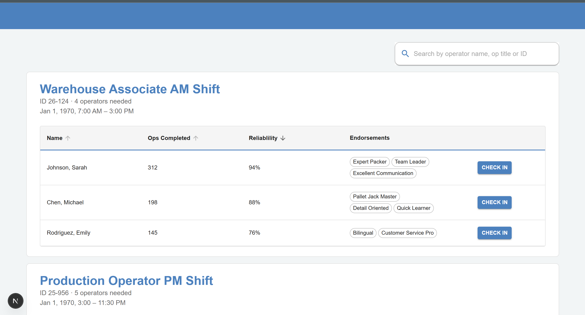

## Veryable Frontend Challenge

### **Goal**

This challenge assesses your proficiency in **React** and **Next.js**, including concepts like **API calls** and handling **loading** and **error states**.

---

### **Problem Statement**

1.  **Clone the starter repository** using the provided link: [Github Repo](https://github.com/Veryable/Frontend-Assessment).
2.  Make a `GET` API call to the endpoint: `https://frontend-challenge.veryableops.com/`. This endpoint provides the data for rendering.

---

### **Screenshot**

---

### **Implementation Notes**

**Structure**

- `src/components`: reusable UI (`DataTable`, `InfoCard`, `SearchInput`, `Pill`, `AnimatedNumber`, `Header`)
- `src/components/ops`: ops-specific UI (`OpsClientPage`, `OpCard`, `CheckInButton`)
- Standard helper files: `src/utils`, `src/hooks`, `src/types`, `src/theme`, `src/providers`

**Features**

- Shared layout with a branded header (Veryable blue theme)
- Fetches ops via `useGetOps` (TanStack Query)
  - Loading and error states
- One `OpCard` per op
  - Fields include title, ID, operators needed (pluralized), date/time range (formatted)
- Operators table inside each card (`DataTable`)
  - Sortable by name, ops completed, and reliability
- Reliability shown as a percent (`formatPercent`)
- Endorsements shown as `Pill`s
- Check In / Check Out button per operator
  - Each toggle adjusts the op's operators-needed count (animated)
- Search by operator name, op title, op ID
  - Normalized seach input
  - Debounce of 300ms
  - "No ops found" empty state

**Potential Future Improvements**

- Warning modal if user checks in more operators than needed
- Pagination as data grows larger
- API call to save check-in state
- Accessability (https://www.w3.org/TR/WCAG21/)
- UI/UX for empty and error states
